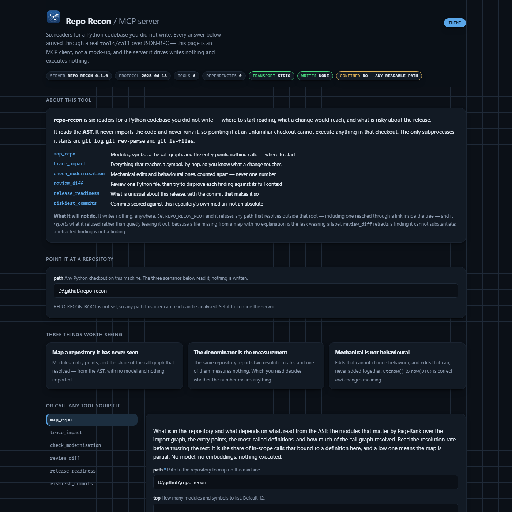
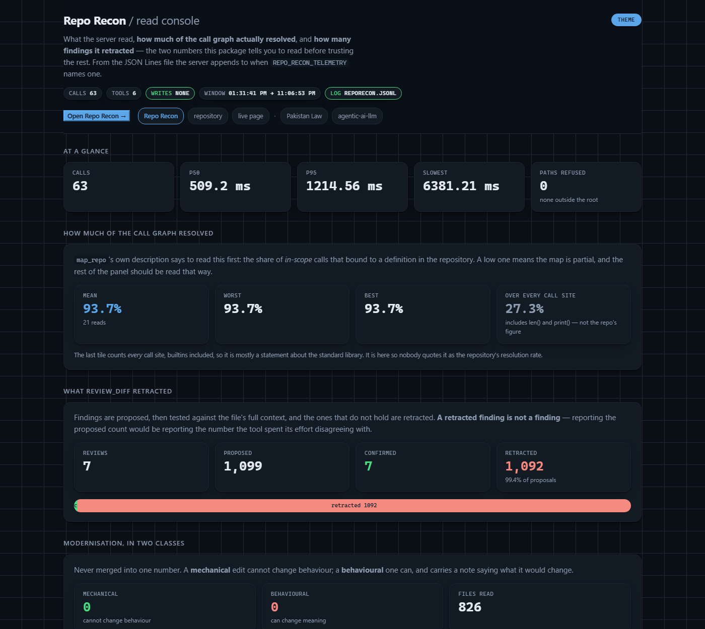

# repo-recon

<!-- mcp-name: io.github.hammasbuilds/repo-recon -->

[](https://github.com/hammasbuilds/repo-recon/actions/workflows/ci.yml)


[](LICENSE)

We built repo-recon, an MCP server with six read-only tools for understanding a Python
codebase you did not write: its structure, what a change would break, what modernising it
would change, which review findings hold up, and whether its history looks safe to release.
It is for developers and coding agents (Claude Code or any MCP client) dropped into an
unfamiliar repository. Source is parsed with `ast` and never imported or executed; the only
subprocesses are `git log`, `git rev-parse` and `git ls-files`, and the only thing that
writes is an optional call log, off unless `REPO_RECON_TELEMETRY` names a file.

## What it does

| Tool | Answers | From |
|---|---|---|
| **`map_repo`** | what is in here, what depends on what, where to start reading | the AST, PageRank over the import graph |
| **`trace_impact`** | what breaks if this definition changes | reversed call edges, capped at three hops |
| **`check_modernisation`** | what can be modernised, and what that would change the *meaning* of | AST rewrite rules, two classes kept apart |
| **`review_diff`** | which review findings survive an attempt to disprove them | propose, verify against full context, retract |
| **`release_readiness`** | is this safe to ship | churn, spread and test-coupling against this repo's own median |
| **`riskiest_commits`** | which commits carry the most risk, and why | the same factors, with the points each contributed |

- Every tool is `readOnlyHint: true`, `openWorldHint: false`, and declares an `outputSchema`
  for the `structuredContent` it returns; the test suite validates every tool's output
  against its schema on every path.
- `map_repo` returns two call-resolution rates. Over every call site in this repository,
  **27.3%** bind to a definition here; over the call sites that *could* (excluding builtins
  and methods on third-party objects), **93.7%** do. `repo_resolution_rate`, the second, is
  the one to read.
- `check_modernisation` reports **mechanical** edits (`List[str]` → `list[str]`, same type at
  runtime) and **behavioural** ones separately and never adds them: `datetime.utcnow()` →
  `datetime.now(timezone.utc)` turns a naive datetime into an aware one, and comparing it
  with a naive one then raises `TypeError`. No tool applies an edit.
- The four underlying tools also install as command lines: `repo-cartographer`,
  `migration-pilot`, `release-captain` and `review-bot` (their original READMEs are in
  [docs/](docs)).

## Screenshots



All six tools on one page. Every answer arrives through a real `tools/call` over
JSON-RPC: the page is an MCP client, and the server it drives writes nothing and
executes nothing.



What the server read, how much of the call graph resolved, and how many findings it
retracted. The two numbers worth reading first: 93.7% of in-scope calls bound to a
definition, and of 1,099 proposed findings 1,092 did not survive being tested against
the file's full context. A retracted finding is not a finding.

## Sample input / output

A `tools/call` over stdio, as an MCP client sends it, on a seven-line file:

```python
import datetime
from typing import List, Optional


def stamp(names: List[str], prefix: Optional[str] = None) -> List[str]:
    now = datetime.datetime.utcnow()
    return [f"{prefix or ''}{n}@{now.isoformat()}" for n in names]
```

```json
{"jsonrpc": "2.0", "id": 2, "method": "tools/call",
 "params": {"name": "check_modernisation", "arguments": {"path": "legacy"}}}
```

`structuredContent` of the reply (real run, `rules_available` omitted):

```json
{
  "files_scanned": 1,
  "files_read": 1,
  "files_skipped": 0,
  "mechanical": 3,
  "behavioural": 1,
  "by_rule": {"pep585-generics": 2, "pep604-optional": 1, "utcnow-deprecated": 1},
  "edits": [
    {"path": "clock.py", "line": 5, "rule": "pep585-generics", "kind": "mechanical",
     "before": "List[str]", "replacement": "list[str]",
     "note": "typing.List and list are the same type at runtime from 3.9"},
    {"path": "clock.py", "line": 5, "rule": "pep604-optional", "kind": "mechanical",
     "before": "Optional[str]", "replacement": "str | None",
     "note": "Optional[X] and X | None are the same annotation from 3.10"},
    {"path": "clock.py", "line": 5, "rule": "pep585-generics", "kind": "mechanical",
     "before": "List[str]", "replacement": "list[str]",
     "note": "typing.List and list are the same type at runtime from 3.9"},
    {"path": "clock.py", "line": 6, "rule": "utcnow-deprecated", "kind": "behavioural",
     "before": "datetime.datetime.utcnow()", "replacement": "datetime.now(timezone.utc)",
     "note": "utcnow() returns a NAIVE datetime; now(timezone.utc) returns an AWARE one. Comparing the two raises TypeError, so this is a semantic change, not a rename. Requires `from datetime import timezone`."}
  ],
  "parse_errors": [],
  "truncated": false
}
```

All six tools run on this repository by `python demo.py`, which is where every number above comes from.
The AST half is pinned by a test; the git half names the commit it was measured at, and a
test re-runs `release_readiness` at that commit to reproduce it. `python demo.py
--update-readme` rewrites this block and the two rates above from one run:


```
map_repo - what is in here
--------------------------
59 modules, 674 symbols, 14,624 lines
call graph: 1094 of 1168 in-scope calls bound to a definition here (93.7%)
  the same number over EVERY call site, builtins included: 27.3% - which measures nothing
core modules by PageRank over the import graph:
  reporecon.captain.history
  reporecon.cartographer.parse
  reporecon.mcp_server
  reporecon.reviewbot.checks
  reporecon.captain.risk
entry points - called by nothing in this repository:
  observability.collect.summarise
  observability.collect.read
  observability.serve.Console.do_GET
  reporecon.reviewbot.verify.FileContext.build
  observability.serve.Console.do_POST

trace_impact - what breaks if this changes
------------------------------------------
reporecon.cartographer.parse.parse_repo is reached by 52 definition(s):
  hop_1: reporecon.cartographer.cli._compare_command, reporecon.cartographer.cli._impact_command, reporecon.cartographer.report.build_report, reporecon.mcp_server.ReconServer.trace_impact
  hop_2: demo._run, reporecon.cartographer.cli._map_command, reporecon.mcp_server.ReconServer.map_repo, tests.cartographer.test_annotated_parameters_resolve.test_a_call_on_an_annotated_parameter_resolves
  hop_3: demo.main, tests.test_mcp_server.test_a_bad_integer_argument_says_the_range, tests.test_mcp_server.test_a_link_inside_the_root_does_not_reach_outside_it, tests.test_mcp_server.test_nothing_is_written_while_the_tools_run

check_modernisation - and what it would change
----------------------------------------------
22 of 22 files read: 0 mechanical, 0 behavioural
  rules available: naive-now, pep585-generics, pep604-optional, pep604-union, utcfromtimestamp-deprecated, utcnow-deprecated
  nothing to modernise - this package is already written for 3.10+

review_diff - only what survived a disproof attempt
---------------------------------------------------
2 proposed, 2 confirmed, 0 retracted
  line 967: assert-in-source - assert is removed under `python -O`, so this check may not run
  line 1058: swallowed-exception - `except NotAGitRepository: return` discards the error and continues

the same checks over four functions written to exercise them:
  5 proposed: 2 confirmed, 2 disproved, 1 acknowledged
  kept     line 1: mutable-default
  kept     line 25: swallowed-exception
  dropped  line 7: mutable-default - the default is never mutated inside count(); sharing it between calls cannot be observed
  dropped  line 13: mutable-default - the author marked it: 'noqa: B006' on line 13
  dropped  line 24: open-without-with - the handle is consumed immediately and not retained

release_readiness - the whole history audited, not a release decision
---------------------------------------------------------------------
verdict: warn over 51 commits
  measured at 3e4fc4b19454
  pass  source changes without tests: 1 of 31 source-changing commits changed no test file
  warn  riskiest commit: 55.7 against a median of 31.7 for this release (1.8x) - 8b659616 agentic-ai-lab: eleven tools, 376 tests, no dependencies and
  warn  areas touched: 7 top-level areas: (root), .github, docs, observability, scripts, src, tests
  warn  commits far above this repo's median: 1 commit(s) over 2460 lines (20x the 123-line median)

riskiest_commits - with the score's components
----------------------------------------------
a normal commit here is 123 lines across 4 files
   55.7  8b659616  agentic-ai-lab: eleven tools, 376 tests, no 
         files 25.0, spread 20.0, volume 10.7
   54.7  f21541b7  Four readers for an unfamiliar codebase, beh
         files 25.0, spread 20.0, volume 9.7
   54.5  0e0a8d97  A commit message that adds a commit, a 30 KB
         files 25.0, spread 20.0, volume 9.5
```

## Results

**Call resolution on other people's code.** This repository is the easy case: one author,
one style, no metaclasses or plugin registries. `scripts/fetch_corpus.py` fetches twelve
projects at pinned tags, chosen for what defeats static resolution, and
`scripts/resolution_sweep.py` runs `map_repo` over each:

```
  project        modules  symbols     lines    repo     all
  ----------------------------------------------------------
  attrs               51    1,558    17,569  52.9%  32.0%
  black              261    2,305   125,828  52.8%  21.0%
  click               47    1,277    16,373  66.4%  38.3%
  flask               65    1,498    16,862  30.8%  16.9%
  httpx               60    1,248    18,011  65.4%  35.8%
  jinja               60    1,770    22,532  58.2%  34.7%
  pydantic           292   10,216   110,092  71.2%  39.8%
  pytest             256    6,109    92,545  61.6%  39.6%
  requests            36      753    11,245  35.9%  19.2%
  rich               190    2,016    38,773  78.5%  53.8%
  sqlalchemy         687   37,006   576,683  66.3%  47.6%
  starlette           67    1,524    17,123  54.3%  35.4%

  median 59.9%, worst 30.8%, best 78.5%
```

Plan against the median: on someone else's code the tool binds about three call sites in
five, and on a decorator-driven framework fewer than one in three. Of the unresolved calls,
64% are `variable.method` where nothing states the variable's type (the ceiling of AST-only
resolution), 22% bare names, 11% multi-hop attributes and 3% `Class.method` on a class the
project owns. Following return annotations (`app = make_app()` where `make_app() -> App`)
resolves `app.route` to `App.route`.

## Tech stack

- Python 3.10+, standard library only (`ast`, `json`, `subprocess` for `git`)
- MCP over stdio (JSON-RPC), with `inputSchema` / `outputSchema` per tool; `server.json`
  is the MCP Registry manifest
- git (history tools)
- pytest, ruff, jsonschema (dev only), GitHub Actions on Python 3.10 to 3.13

## Run it

```bash
git clone https://github.com/hammasbuilds/repo-recon
cd repo-recon
pip install -e .
repo-recon-mcp --check     # prints what it exposes and exits
python demo.py             # all six tools on this repository

uv sync --all-groups && uv run pytest -q
```

Add it to an MCP client (Claude Code, or anything that speaks the protocol):

```json
{
  "mcpServers": {
    "repo-recon": {
      "command": "repo-recon-mcp",
      "env": { "REPO_RECON_ROOT": "/path/to/your/code" }
    }
  }
}
```

`REPO_RECON_ROOT` is optional and worth setting: every path argument is resolved and refused
if it falls outside it. See [SECURITY.md](SECURITY.md).

`server.json` declares `registryType: "pypi"` at the package's current version, which is
what the [MCP Registry](https://registry.modelcontextprotocol.io) needs and
is **not** a statement that the upload has happened: this package is not on PyPI yet.
Upload to PyPI first, then submit the manifest; submitted earlier, every client that
installs from it fails at `uvx repo-recon`.

What it will and will not do:

- **No network.** Nothing opens a socket.
- **No writes through the MCP server.** All six tools only read; a test fingerprints every
  file under a repository, calls all six tools, and diffs. The command line is a different
  surface: `migration-pilot apply --write` rewrites the files it is pointed at, and is
  reachable only from a shell.
- **Nothing of yours is executed.** Every subprocess is `git` with a fixed argument list and
  `shell=False`: **five** per history call (`rev-parse --verify`, `log`, `rev-parse
  --absolute-git-dir`, `rev-parse --is-shallow-repository`, `ls-files -z`) and **six** when
  `REPO_RECON_ROOT` is set, none for `map_repo`, `trace_impact`, `check_modernisation` or
  `review_diff`.
- **No dependencies.** Standard library only.
- It is not a security scanner, and `review_diff`'s surviving findings are a noise filter,
  not a guarantee.

## Licence

MIT, see [LICENSE](LICENSE).
