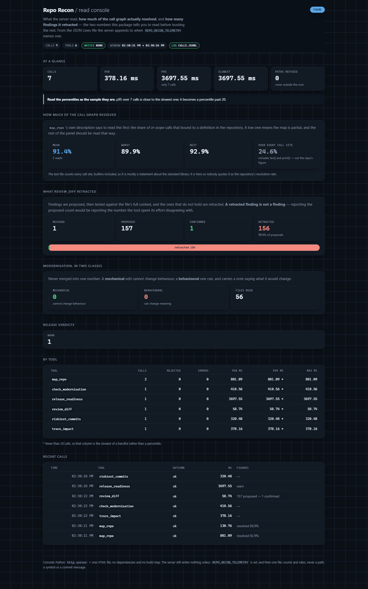

# observability

A read console for the MCP server: what it read, **how much of the call graph actually
resolved**, and **how many findings it retracted**.

Zero dependencies, like the rest of the package — `http.server`, one HTML file, a JSON
Lines log. No Prometheus, no Grafana, no database, no build step.



*Real reads: resolution 91.7% against 24.8% over every call site, and a review that proposed 157 findings and kept 1.*

```bash
# 1. run the server with recording on. Off unless this names a file.
REPO_RECON_TELEMETRY=calls.jsonl repo-recon-mcp

# 2. in another terminal, read what it wrote
python observability/serve.py calls.jsonl
```

## Off unless you ask

This package's headline is that the server's tools **write nothing**. That is why
`REPO_RECON_TELEMETRY` unset means no file is created and nothing is appended, anywhere:
the claim stands exactly as written. Set the variable and the server writes one file — the
one you named — and the tools still write nothing, and the confinement root still refuses
every path outside it. Deleting the file is a complete uninstall.

## What is in the file

One JSON object per line, appended:

```json
{"at": 1760000000.12, "tool": "map_repo", "outcome": "ok", "ms": 493.04,
 "repo_resolution_rate": 0.9355, "resolution_rate": 0.2478, "modules": 55, "refused_paths": 0}
```

**Counts and rates only — never a path, a symbol or a commit message.** A path on
somebody's disk is about them, `refused_paths` is reduced to its length, and
`tests/test_telemetry.py` asserts that the repository path put through the server does not
appear in the log it produced.

Recording sits on `ReconServer.call`, so a call is recorded however it arrived — over the
protocol or from a direct caller. It was in the protocol dispatch first, and this
repository's own tests call `server.map_repo({...})` directly, so every one of them
produced no event at all.

## What the console shows

| panel | why it is there |
|---|---|
| **How much of the call graph resolved** | `map_repo`'s own description says to read this first. Mean, worst and best across reads — and beside it the rate over *every* call site, `len()` and `print()` included, so nobody quotes that one as the repository's figure |
| **What `review_diff` retracted** | proposed against confirmed, as one bar. A real run: 157 proposed, 1 confirmed, **156 retracted**. Reporting the proposed count would be reporting the number the tool spent its effort disagreeing with |
| Modernisation | mechanical against behavioural, never merged into one number |
| Release verdicts | pass / warn / block, counted |
| Paths refused | the confinement doing its job |
| By tool, Recent calls | calls, rejections, errors, latency; then the tail |

A percentile over fewer than twenty calls is marked as the handful it is, on the page and
in the per-tool table.

## What it does not do

- It does not write to the log. It reads.
- It does not start the MCP server.
- It binds `127.0.0.1` only, and that is not configurable. A call log is a record of which
  repositories somebody read.
- It computes nothing in the page. Every number comes from `collect.py`, pure functions
  over the events, tested without a server.
